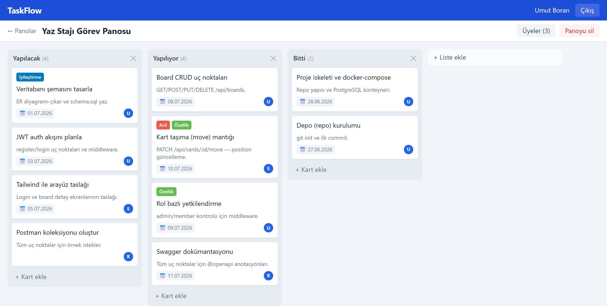
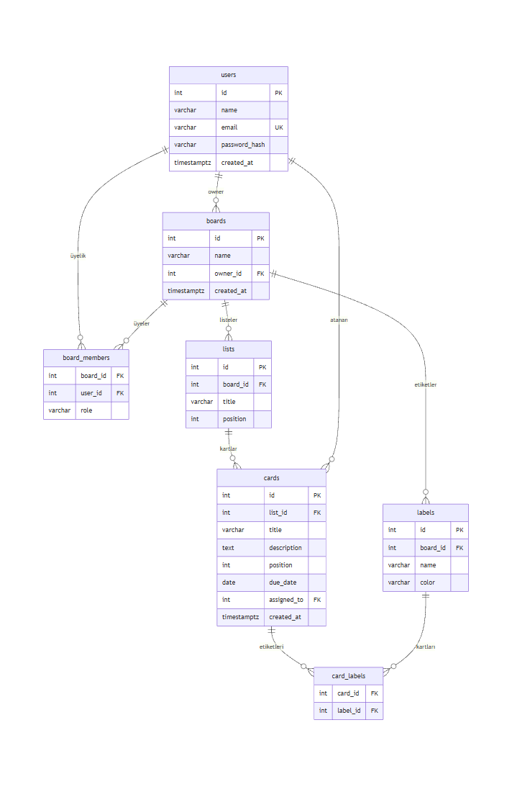

# TaskFlow – Kanban Görev Takip Uygulaması

Trello benzeri bir görev takip uygulaması. Kullanıcı pano oluşturuyor, panoya liste (Yapılacak / Yapılıyor / Bitti gibi) ve listelere kart ekliyor, kartları sürükle-bırak ile listeler arasında taşıyor. Panoya e-postayla başka kullanıcılar davet edilebiliyor, her üyenin rolü (yönetici / üye) var.

Yaz stajımda geliştirdim. İlk sürümü bitirdikten sonra uygulamaya OWASP ZAP ve elle yazdığım testlerle güvenlik testi yaptım, bulunan açıkları kapattım.



## Kullanılan teknolojiler

| Katman | Teknoloji |
|---|---|
| Backend | Node.js, Express |
| Veritabanı | PostgreSQL, `pg` ile parametreli SQL (ORM kullanmadım) |
| Giriş | JWT, şifreler bcrypt ile hashleniyor |
| API dokümanı | Swagger (`/api-docs`), Postman koleksiyonu |
| Frontend | React (Vite), Tailwind CSS |
| Sürükle-bırak | @dnd-kit |
| Güvenlik testi | OWASP ZAP, Python ile manuel testler, Newman |

## Yapı

```
[ React ]  --REST / JWT-->  [ Express API ]  --parametreli SQL-->  [ PostgreSQL ]
```

- `routes/` uç noktalar ve Swagger açıklamaları, `controllers/` iş mantığı ve SQL sorguları, `middleware/` giriş kontrolü, yetki ve hata yönetimi.
- Her istekte kullanıcının o panodaki rolü `board_members` tablosundan kontrol ediliyor. İstek liste ya da kart üzerinden gelse bile önce bağlı olduğu pano bulunuyor, yetki ona göre veriliyor.
- Kart taşıma tek bir transaction içinde yapılıyor: eski listedeki kartlar bir yukarı kayıyor, yeni listede yer açılıyor, kart yeni sırasına yerleşiyor. Yarıda hata olursa hiçbir şey değişmiyor.

Veritabanı şeması `schema.sql` içinde, ER diyagramı:



## Kurulum

Node.js 18+ ve PostgreSQL gerekiyor. Docker varsa veritabanı tek komutla kalkıyor:

```
cp .env.example .env
docker compose up -d
```

İlk açılışta `schema.sql` ve `seed.sql` otomatik çalışıyor. Docker yoksa kendi PostgreSQL'inde `backend/.env` içindeki `DATABASE_URL`'i ayarlayıp `npm run db:seed` çalıştırmak yeterli.

Backend:

```
cd backend
cp .env.example .env
npm install
npm run dev
```

API `http://localhost:4000`, Swagger `http://localhost:4000/api-docs` adresinde açılıyor.

Frontend:

```
cd frontend
npm install
npm run dev
```

Arayüz `http://localhost:5173` adresinde açılıyor.

## Demo kullanıcılar

`seed.sql` ile gelen kullanıcıların hepsinin şifresi `demo1234`.

| E-posta | Rol |
|---|---|
| `umut@taskflow.dev` | pano sahibi (yönetici) |
| `ayse@taskflow.dev` | yönetici |
| `elif@taskflow.dev` | üye |

Bir panoda birden fazla yönetici olabiliyor ama pano sahibi panodan çıkarılamıyor.

## API

| Metod | Yol | Açıklama |
|---|---|---|
| POST | `/api/auth/register`, `/api/auth/login` | kayıt, giriş (JWT döner) |
| GET | `/api/auth/me` | giriş yapan kullanıcı |
| GET, POST | `/api/boards` | panolar |
| GET, PUT, DELETE | `/api/boards/:id` | pano detay, düzenleme, silme (yönetici) |
| POST, DELETE | `/api/boards/:id/members` | üye davet etme, çıkarma (yönetici) |
| GET, POST, PUT, DELETE | `/api/boards/:boardId/lists` | listeler |
| GET, POST, PUT, DELETE | `/api/lists/:listId/cards` | kartlar |
| PATCH | `/api/cards/:id/move` | kartı başka listeye / sıraya taşıma |
| POST, DELETE | `/api/cards/:id/labels` | etiket ekleme, kaldırma |

Hepsi Swagger'da örnekleriyle duruyor. `postman/` klasöründeki koleksiyonda giriş isteği token'ı kendisi kaydediyor, diğer istekler sırayla çalıştırılabiliyor.

## Güvenlik testi

İlk sürümde bazı önlemler yoktu (güvenlik başlıkları, istek sınırlama, CORS kısıtı, hata mesajlarının sadeleştirilmesi). Uygulamayı 23 manuel test ve OWASP ZAP taramasıyla test ettim:

- İlk durumda 7 bulgu çıktı. Yetki kontrolü, SQL injection ve XSS testleri baştan güvenliydi.
- `helmet`, `express-rate-limit`, CORS kısıtı, merkezi hata yönetimi ve id doğrulaması ekledim.
- Düzeltmeden sonra ZAP taramasında yüksek, orta ve düşük risk bulgusu kalmadı.

Ayrıntılar `docs/guvenlik-raporu.md` dosyasında. ZAP raporları ve test çıktıları (önce / sonra) `docs/guvenlik/` klasöründe.

## Eksikler

- Kartlara yorum ve dosya ekleme yok.
- Değişiklikler diğer kullanıcılara anlık gitmiyor, sayfanın yenilenmesi gerekiyor.
- Otomatik birim testleri yazılmadı, testler manuel ve Postman üzerinden.
